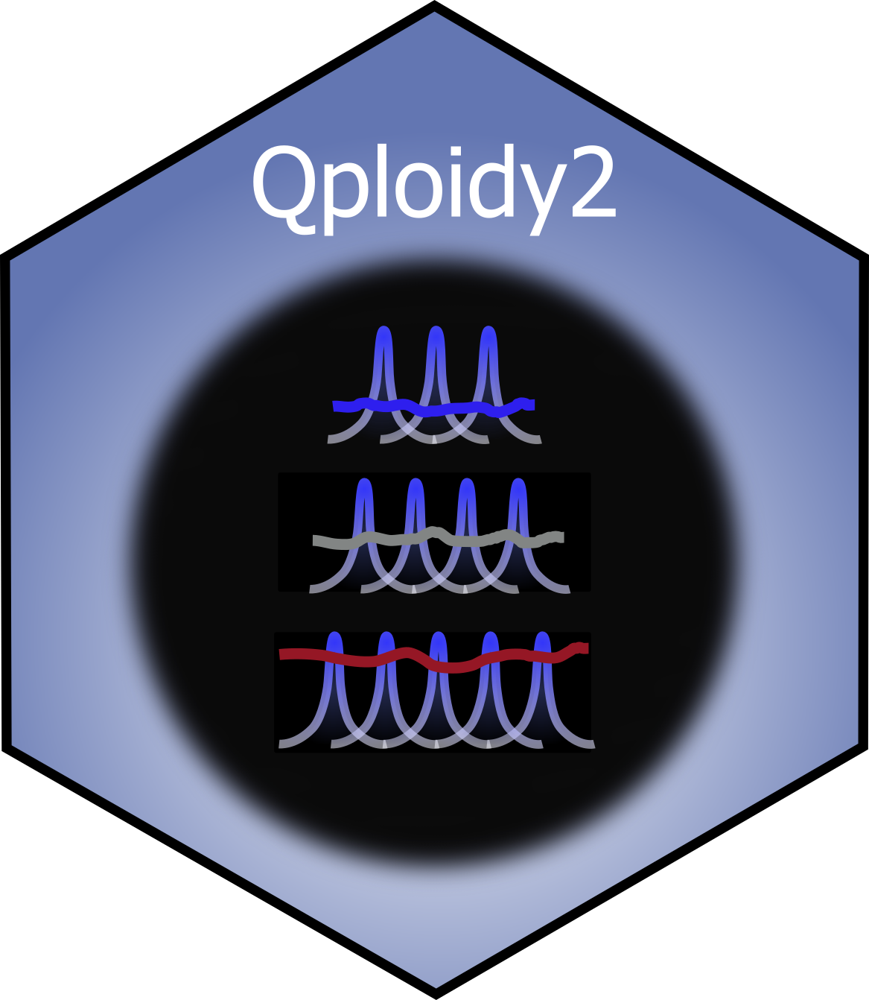

<!-- badges: start -->
[](https://www.repostatus.org/#active)
[](https://github.com/Breeding-Insight/Qploidy2/releases/latest)
<!-- CRAN badge: uncomment once Qploidy2 is on CRAN
[](https://CRAN.R-project.org/package=Qploidy2)
-->
[](https://github.com/Breeding-Insight/Qploidy2/actions/workflows/R-CMD-check.yaml)
[](https://codecov.io/gh/Breeding-Insight/Qploidy2)
[](https://www.gnu.org/licenses/agpl-3.0)
[](https://scicrunch.org/resolver/RRID:SCR_028622)
<!-- badges: end -->

# Qploidy2



**`Qploidy2`** is an R package for estimating large-scale copy number variation, ploidy, and aneuploidy from genotyping platform data.

`Qploidy2` builds on the original [`Qploidy`](https://github.com/Cristianetaniguti/Qploidy) package. `Qploidy` focused on standardizing signals to reduce noise, and its ploidy estimates relied heavily on visual inspection of diagnostic plots. `Qploidy2` adds a multipoint Hidden Markov Model (HMM) that combines standardized allele ratios (BAF) with total depth or intensity (z-scores) to estimate copy number automatically and robustly.

You can use `Qploidy`'s standardization within `Qploidy2`, or apply the HMM directly to your data when noise reduction isn't needed.

## Installation

``` r
# Install the development version from GitHub
# install.packages("devtools")
devtools::install_github("Breeding-Insight/Qploidy2")
```

## Main functions

| Function | What it does |
|---|---|
| `standardize()` | Standardizes allele ratios (BAF) and total depth or intensity (z-scores) against reference samples to reduce noise. |
| `hmm_estimate_CN_multi()` | Estimates copy number along the genome for many samples in parallel with the HMM (`hmm_estimate_CN()` for a single sample). |
| `count_types()` | Classifies samples as euploid, aneuploid, or segmental aneuploid. |
| `compare_cn_track_summary()` | Shows the copy number of every sample and chromosome in one plot, grouped by sample ploidy and aneuploidy type. |
| `plot_karyotype()` | Draws a sample's karyotype with the copy number of each chromosome and ISCN-style notation. |
| `plot_cn_track()` | Plots BAF, z-scores, and copy number calls along the genome for one sample. |
| `write_hmm_CN()` | Writes the results to files, for sharing or for curation in `GenoBrew`. |

## Quick start

A minimal workflow, assuming `data`, `genos`, and `geno.pos` are already prepared (see the [Prepare input files tutorial](https://Breeding-Insight.github.io/Qploidy2/Prepare_inputs_Qploidy.html)):

``` r
library(Qploidy2)

std <- standardize(data = data, genos = genos, geno.pos = geno.pos,
                   ploidy.standardization = 4)

res <- hmm_estimate_CN_multi(qploidy_standarize_result = std,
                             cn_grid = 2:6, n_cores = 2)

count_types(res)
compare_cn_track_summary(res)
plot_karyotype(res, sample_name = "Sample1")
plot_cn_track(hmm_CN = res, qploidy_standarize_result = std, sample_id = "Sample1")
write_hmm_CN(res, prefix = "my_results")
```

For choosing parameters, filtering samples, and re-standardizing, follow the [alfalfa tutorial](https://Breeding-Insight.github.io/Qploidy2/Qploidy_alfalfa_tutorial.html), which walks through a complete analysis.

## Documentation

* [Prepare input files](https://Breeding-Insight.github.io/Qploidy2/Prepare_inputs_Qploidy.html): building `data`, `genos`, and `geno.pos` from VCF, Axiom, or Illumina files.
* [Aneuploidy detection with DArTag markers in an alfalfa F1 population](https://Breeding-Insight.github.io/Qploidy2/Qploidy_alfalfa_tutorial.html): large-scale copy number estimation in an alfalfa mapping population using DArTag sequencing data.
* [Qploidy2 and nQuack integration](https://Breeding-Insight.github.io/Qploidy2/Qploidy2_nQuack_tutorial.html): the same population analyzed with nQuack's EM-based BAF model selection.

## Interactive visualization and curation of results

Files written by `write_hmm_CN()` can be uploaded to the `GenoBrew` Shiny app. Its **CNV profiles** tab lets you inspect the BAF, z-score, and copy number plots interactively, re-run the HMM with adjusted parameters for specific samples, and update the results.

See the `GenoBrew` [repository](https://github.com/Breeding-Insight/GenoBrew) and [tutorial](https://scribehow.com/viewer/GenoBrew_Interactive_Marker_Panel_Evaluation_CNV_Visualization_and_Curation__4uWloBuPT1WlnCvW2UWiTg) for more information.

## AI assistant (Claude Code)

`Qploidy2` provides two [Claude Code](https://claude.com/claude-code) skills that guide you through the analysis interactively:

- **`qploidy2-input-prep`**: preparing `data`, `genos`, and `geno.pos` from VCF, Axiom, or Illumina files, including dosage calling with `updog` or `fitPoly`.
- **`qploidy2-analysis`**: the full pipeline, from batch-effect checks, standardization, and BAF model selection to HMM copy number estimation, filtering, visualization, and export.

### Install the skills in Claude Code

Run this in R from your analysis project folder:

``` r
Qploidy2::install_claude_skills()
```

This creates `.claude/skills/qploidy2-input-prep/SKILL.md` and `.claude/skills/qploidy2-analysis/SKILL.md` in the current working directory. Open that folder in Claude Code and the skills load automatically. Invoke one directly with `/qploidy2-analysis`, or describe what you want and Claude picks the relevant skill. To use them in other projects, copy the skill folders into that project's `.claude/skills/` folder, or into `~/.claude/skills/` to make them available everywhere.

### Use in claude.ai

To use the skills in the claude.ai web or desktop app, download the skill files and add them as custom skills in the app's settings:

- [qploidy2-input-prep/SKILL.md](https://raw.githubusercontent.com/Breeding-Insight/Qploidy2/main/.claude/skills/qploidy2-input-prep/SKILL.md)
- [qploidy2-analysis/SKILL.md](https://raw.githubusercontent.com/Breeding-Insight/Qploidy2/main/.claude/skills/qploidy2-analysis/SKILL.md)

### Example prompts

```
/qploidy2-input-prep Help me prepare my input files from this VCF
/qploidy2-analysis Run the HMM on my samples
```

## Contributing

Contributions are welcome! To contribute, fork the repository and open a pull request against the `development` branch. For major changes, open an issue first to discuss your ideas.

## Bug reports

If you find a bug or want an enhancement, please open an issue [here](https://github.com/Breeding-Insight/Qploidy2/issues).

## How to cite

Run `citation("Qploidy2")` in R for the references in BibTeX format.

### Qploidy2: HMM and grid-approach BAF model selection

Manuscript in preparation. Until it is published, please cite the software with its Research Resource Identifier, **RRID:SCR_028622**, and the package version you used:

Taniguti, C. H. et al. Qploidy2: Estimation of large-scale copy number variation using genotyping
data. Manuscript in preparation. R package available at https://github.com/Breeding-Insight/Qploidy2
(RRID:SCR_028622).

### Qploidy: standardization

Taniguti, C. H., Lau, J., Hochhaus, T., Arias, D. C. L., Hokanson, S. C., Zlesak, D. C., Byrne, D. H.,
Klein, P. E., & Riera-Lizarazu, O. (2025). Exploring chromosomal variations in garden roses: Insights
from high-density SNP array data and a new tool, Qploidy. The Plant Genome, e70044.
https://doi.org/10.1002/tpg2.70044

### nQuack: EM-approach BAF model selection

Gaynor, M., Landis, J., O'Connor, T., Laport, R., Doyle, J., Soltis, D., Ponciano, J., & Soltis, P. (2024).
nQuack: An R package for predicting ploidal level from sequence data using site-based heterozygosity.
Applications in Plant Sciences, 12(4), e11606. https://doi.org/10.1002/aps3.11606

## Acknowledgments

### Qploidy version 1.0.0

This work was funded in part by the Robert E. Basye Endowment in Rose Genetics, Dept. of Horticultural Sciences, Texas A&M University, and by USDA's National Institute of Food and Agriculture (NIFA) Specialty Crop Research Initiative (SCRI) projects "Tools for Genomics-Assisted Breeding in Polyploids: Development of a Community Resource" (Award No. 2020-51181-32156) and "Developing Sustainable Rose Landscapes via Rose Rosette Disease Education, Socioeconomic Assessments, and Breeding RRD-Resistant Roses with Stable Black Spot Resistance" (Award No. 2022-51181-38330).

### Qploidy versions after 1.0.0 and Qploidy2

Supported by [Breeding Insight](https://www.breedinginsight.org/).

### Use of AI tools

Parts of the code, unit tests, and documentation of `Qploidy2` were developed with the
assistance of [GitHub Copilot](https://github.com/features/copilot) and
[Claude Code](https://claude.com/claude-code) (Anthropic; Claude Opus and Sonnet models),
used for code review, bug fixing, implementing features specified by the authors, writing
tests, and drafting documentation. All AI-assisted changes were reviewed, tested, and
approved by the package authors, who take full responsibility for the code and its
scientific content.
